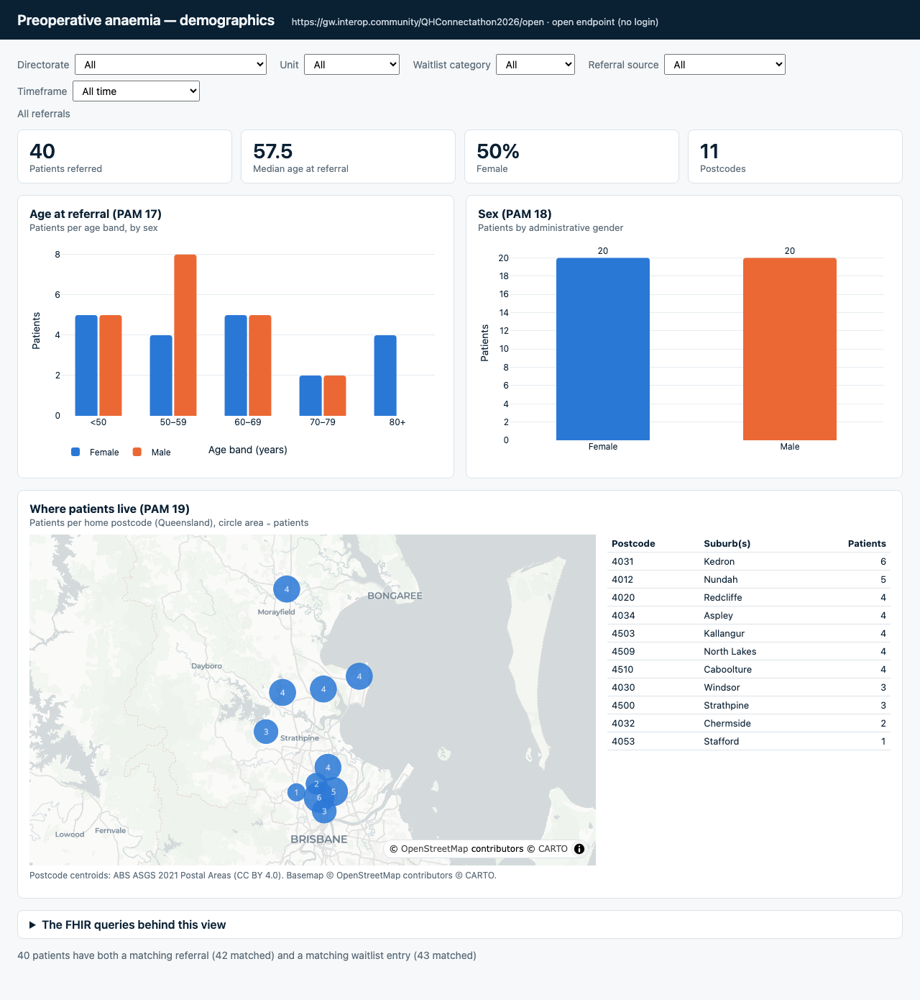

# B7 Demographics (PAM 17, 18, 19)

**Status: verified** (no-login mode against the Meld open endpoint, headless Chromium; numbers checked
against separate FHIR searches). EHR launch from Meld not tested (needs a client registration).

A population SMART app: age at referral in bands by sex (PAM 17), sex (PAM 18) and a Queensland map of
patients per home postcode (PAM 19), with tiles (patients, median age, % female, postcodes). It uses the
shared filter bar from [B8](../B8-filters/) (directorate, unit, waitlist category, referral source,
timeframe), so every chart follows the filters, and the filters are kept in the URL.

Plain HTML + fhirclient.js 2.6.3 + Plotly 4.1.2 (full bundle, for `scattermap`), no build step.

## Try it

* **No login:** serve `solutions/` (the app loads `../B8-filters/pam-filters.js`), e.g.
  `cd solutions && python3 -m http.server 8000`, then
  `http://localhost:8000/B7-demographics/?server=https://gw.interop.community/QHConnectathon2026/open`
  (add filters, e.g. `&directorate=surgical&category=2`). On GitHub Pages:
  `<pages-base>/solutions/B7-demographics/?server=https://gw.interop.community/QHConnectathon2026/open`
  (deploy `B7-demographics/` and `B8-filters/` side by side).
* **From Meld (EHR launch, population view):** register an app with
  * Launch URI: `<pages-base>/solutions/B7-demographics/launch.html`
  * Redirect URI: `<pages-base>/solutions/B7-demographics/`
  * Scopes (SMART v1): `launch openid fhirUser online_access user/*.read`

  and put the client ID in `launch.html` (`CLIENT_ID`). Launch with any patient selected (Meld needs one);
  the app ignores it and reads the population.

## How it works (FHIR)

1. Cohort (B8 module): `ServiceRequest?code=http://snomed.info/sct|3457005&…` (referrals to blood management,
   with referral source / timeframe filters) and `ServiceRequest?category=<elective-category>|…&performer=…`
   (waitlist entries, with category / unit / directorate filters), joined on the patient.
2. `Patient?_id=<cohort ids>` (40 ids per request).
3. Age = whole years from `birthDate` to the referral's `authoredOn`; bands <50, 50–59, 60–69, 70–79, 80+.
   Sex = `Patient.gender`. Postcode = `address` with `use = home` (else the first), `postalCode`.
4. Map: Plotly `scattermap` (MapLibre) on the free CARTO Positron basemap — **no API key**. Each postcode
   is a circle at its postal-area centroid, area ∝ patients; a table beside the map gives the same data
   (and lists any postcode without a centroid as "not on map").

### Postcode centroids (source)

`qld-postcode-centroids.js` holds a centroid for all 433 Queensland postal areas, built by
`build-postcodes.py` from the **ABS ASGS Edition 3 (2021) Postal Areas** (ArcGIS REST service
`geo.abs.gov.au/arcgis/rest/services/ASGS2021/POA/MapServer/0`, **CC BY 4.0**): generalised polygons
(~1 km tolerance), area-weighted centroid computed locally. Postal Areas approximate postcodes, so the points
are for display only. Rebuild with `python3 build-postcodes.py` (no key needed). An unlicensed community
postcode CSV was considered and rejected.

## Verified

`node solutions/B7-demographics/verify.mjs` (from the track folder; Playwright from `decks/node_modules`)
serves `solutions/`, opens the app headless with `?server=<open endpoint>` and compares with plain FHIR searches
written separately in the script (28 Oct 2026 run: **ALL PASS**):

| Check | App | FHIR |
|---|---|---|
| Patients (referral + waitlist entry) | 40 | 40 |
| Sex female / male | 20 / 20 | 20 / 20 |
| Age bands female (<50, 50s, 60s, 70s, 80+) | 5, 4, 5, 2, 4 | same |
| Age bands male | 5, 8, 5, 2, 0 | same |
| Patients per postcode (11 postcodes) | 4031: 6, 4012: 5, … | same |
| Every postcode in the data has a centroid | yes | |
| Filter `directorate=surgical`: female / male | 8 / 15 | `Patient?gender=…&_has:ServiceRequest:subject:performer=…` 8 / 15 |
| Filter `category=1&source=surgeon`: female / male | 5 / 2 | `_has` searches 5 / 2 |
| Page errors | none | |

Screenshots: `screenshot-all.png`, `screenshot-directorate-surgical.png`, `screenshot-category-1-source-surgeon.png`.

## Not verified / gaps / decisions

* EHR launch from Meld (no client registration made; same pattern as `apps/pam-dashboard`).
* **Cohort = patients with a blood-management referral *and* a surgical waitlist entry.** Patients other
  teams add to the shared sandbox count when they have both (one did, briefly, during testing);
  `pam-demo` / `pam-spike-1` have neither and are left out.
* Age is at the referral date (not today); the dashboard's original definition should be confirmed.
* Bands are 10-year bands with <50 and 80+ open-ended (the data's ages are 38–86); change `BANDS` in `index.html`.
* `gender` other/unknown get their own bars if present (none in the data).
* The map needs network access to CARTO tiles (`basemaps.cartocdn.com`); without it the circles still draw.
* Postcode → "Queensland only": interstate postcodes have no centroid and are listed in the table only.
