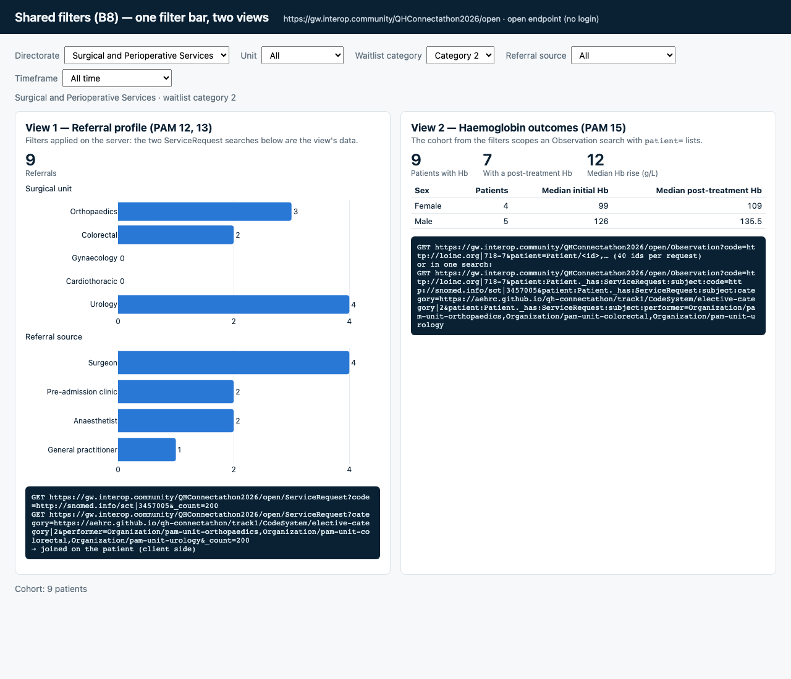

# B8 Shared filters (PAM 1–5)

**Status: verified** (every filter tested against the Meld open endpoint; demo page run headless in
no-login mode and checked against separate FHIR searches). EHR launch not tested (needs a client registration).

The dashboard's filters — **directorate, timeframe, waitlist category, unit, referral source** — as FHIR search
parameters, in one small reusable script, [`pam-filters.js`](pam-filters.js) (no build step; `window.PamFilters`
in a page, `require()` in Node). It is used by two views on the demo page here (`index.html`: referral profile
PAM 12–13, Hb outcomes PAM 15) and by the [B7 demographics app](../B7-demographics/).



## Where each filter lives, and how it is searched

All five are **real search parameters on Meld** (HAPI FHIR 6.0.0). Only *directorate* needs a client-side
lookup first, because the synthetic data has no directorates.

| Filter | Data element (per the [mapping](../../FHIR-Mapping-DRAFT.md)) | Search on Meld | Server-side? |
|---|---|---|---|
| Timeframe | referral `ServiceRequest.authoredOn` (code SNOMED 3457005) | `ServiceRequest?code=http://snomed.info/sct\|3457005&authored=ge2025-07-01&authored=le2026-06-30` | yes |
| Referral source | referral `ServiceRequest.category` (local `referral-source`) | `…&category=https://aehrc.github.io/qh-connectathon/track1/CodeSystem/referral-source\|surgeon` | yes |
| Waitlist category | waitlist `ServiceRequest.category` (local `elective-category`) | `ServiceRequest?category=…/elective-category\|2` (no filter: `…/elective-category\|` = any code in that system) | yes |
| Unit | waitlist `ServiceRequest.performer` (Organization) | `…&performer=Organization/pam-unit-orthopaedics` | yes |
| Directorate | **not in the data** | expanded client-side from a lookup (`DIRECTORATES`) to `performer=Organization/a,Organization/b,…` | search yes, lookup client-side |

Combining them: a patient is in the cohort if they have a matching **referral** and a matching **waitlist
entry**. `PamFilters.cohort(search, filters)` runs exactly two searches (referral; waitlist entry), each fully
filtered on the server, and joins them on `subject` in the browser. A view then scopes its own search to the
cohort with `patient=Patient/a,Patient/b,…` (40 ids per request; `PamFilters.searchScoped`).

**One-search alternative (also works on Meld):** reverse chaining with `_has`, e.g.

```
Patient?_has:ServiceRequest:subject:category=…/elective-category|2&_has:ServiceRequest:subject:performer=Organization/…
Observation?code=718-7&patient:Patient._has:ServiceRequest:subject:category=…/elective-category|2
```

(`PamFilters.hasParams(filters, prefix)`). Meld supports both `_has` on Patient and `patient:Patient._has` /
`patient._has` chains from Observation and EpisodeOfCare. **Caveat:** each `_has` is matched against *any*
ServiceRequest of the patient independently, so `_has:ServiceRequest:subject:authored=…` also matches the
waitlist entry's `authoredOn`, and the timeframe filter returns too many patients (FY 2025–26: 30 instead of 27;
Q2: 12 instead of 8). That is why `cohort()` uses two searches. Other filters give identical results both ways.
A cleaner `_has` would need a search parameter that tells the two ServiceRequests apart (e.g. a distinct
`category` system on both, which the referral already has, combined *within one* `_has` — not possible in R4)
or a custom SearchParameter.

Also tested and working: `ServiceRequest?performer:Organization.partof=Organization/pam-blood-management`
(chained). If directorates were Organizations with units as `partOf` children, directorate would become one
chained parameter with no client-side lookup.

## Module API (pam-filters.js)

| Function | Does |
|---|---|
| `renderBar(el, onChange)` | Draws the five selects (+ custom dates) into `el`, keeps filters in the URL (`?directorate=…&unit=…&category=…&source=…&from=…&to=…`), calls `onChange(filters)` |
| `cohort(search, f)` | Two filtered ServiceRequest searches → `{ patientIds, referrals, waitlist, queries }` (latest matching referral / waitlist entry per patient) |
| `searchScoped(search, base, ids, {param, prefix})` | Runs `base` restricted to the cohort with `patient=` (or `_id=`, `subject=`) chunks |
| `searchParams(f)`, `cohortQueries(f)`, `hasParams(f, prefix)` | The search parameters / query strings, for apps that want to build their own |
| `timeframes()` | Presets: All, current and previous financial year, their quarters, last 90 days |
| `describe(f)`, `fromUrl()`, `toUrl(f)` | Text summary, URL round-trip |

`search` is any function returning a flat array of resources for a relative query, e.g. with fhirclient:
`(q) => client.request(q, { pageLimit: 0, flat: true })`. `|` is written as `%7C` (Meld rejects a raw `|`).

## Try it

* **No login:** serve this folder (or `solutions/`) and open
  `index.html?server=https://gw.interop.community/QHConnectathon2026/open` (add e.g. `&directorate=surgical&category=2`).
* **From Meld:** register launch URI `<pages-base>/solutions/B8-filters/launch.html`, redirect URI
  `<pages-base>/solutions/B8-filters/`, SMART v1 scopes `launch openid fhirUser online_access user/*.read`;
  put the client ID in `launch.html`. Launch with any patient selected.
* **Use it in your app (B3–B7):** `<script src="pam-filters.js"></script>`, a `<div id="filters">`, then
  `PamFilters.renderBar(div, f => redraw(f))` and `const c = await PamFilters.cohort(search, f)`.

## Verified (28 Oct 2026)

* `node test-filters.mjs` (in this folder): every filter value, combinations and an empty combination, three ways —
  *truth* computed in JS from all ServiceRequests, `cohort()`, and the one-search `_has` form. **ALL PASS** for
  `cohort()`; `_has` agrees except for the timeframe (above). Full table in [`test-results.txt`](test-results.txt).
  Also: Hb Observations for a filtered cohort via `patient=` chunks = via `patient:Patient._has` (16 = 16).
* `node solutions/B8-filters/verify-views.mjs` (from the track folder): opens the demo page headless for four
  filter sets (none; surgical + category 2; surgeon in FY 2025–26; Gynaecology) and checks the cohort, view 1
  (referrals by unit and by source) and view 2 (Hb observations, patients with Hb / post-treatment Hb, median Hb
  rise) against hand-written FHIR searches. **ALL PASS** ([`verify-views-output.txt`](verify-views-output.txt));
  screenshots `screenshot-*.png`.

## Gaps and decisions for the track leads

* **Directorate grouping is made up** (`DIRECTORATES` in `pam-filters.js`: Surgical and Perioperative = Orthopaedics,
  Colorectal, Urology; Women's and Newborn = Gynaecology; Heart and Lung = Cardiothoracic). Replace with Metro North's
  real one, or better, add directorate Organizations to the data and use `performer:Organization.partof`.
* **Timeframe = referral date** (`authoredOn` of the blood-management referral). Other candidates: episode start, surgery date.
* Patients with several referrals / waitlist entries match if *any* matches (same as `_has`); views show the latest.
* Waitlist category and referral source use the track's placeholder local code systems; the module only needs the
  system URLs changed (`SYS`) when the mapping is agreed.
* Not used: `_filter` (listed in the CapabilityStatement, but HTTP 400 "HAPI-1016: _filter parameter is disabled on this server"), `_has` for the timeframe (see caveat).
* The test results reflect a shared sandbox that other teams write to; other teams' test patients with both a
  referral and a waitlist entry are part of the cohort.
